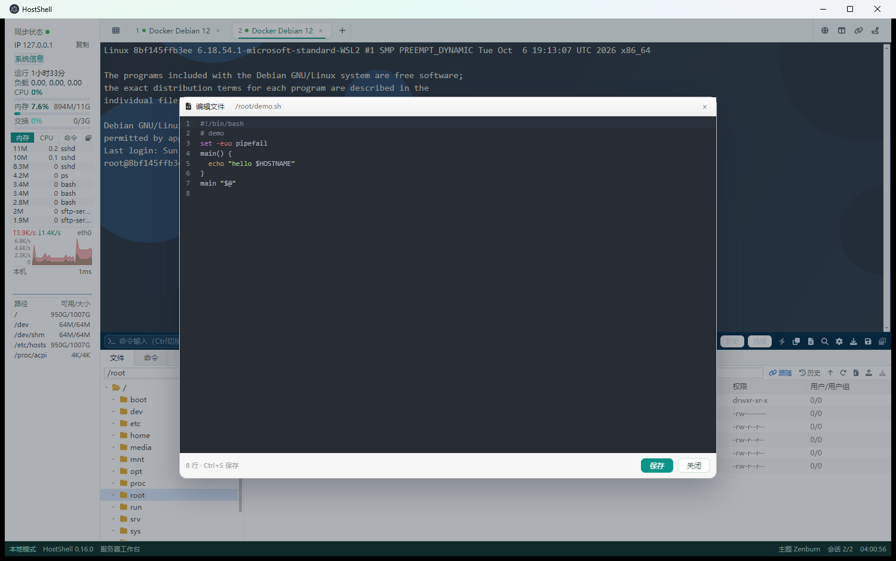
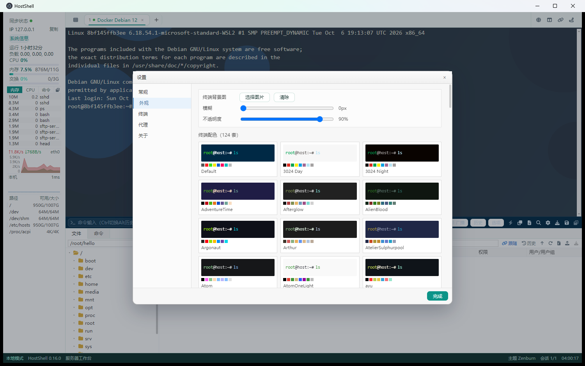
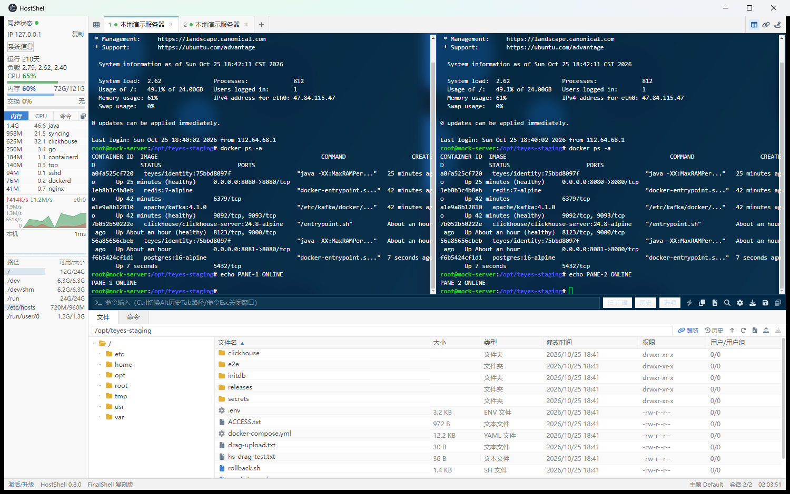
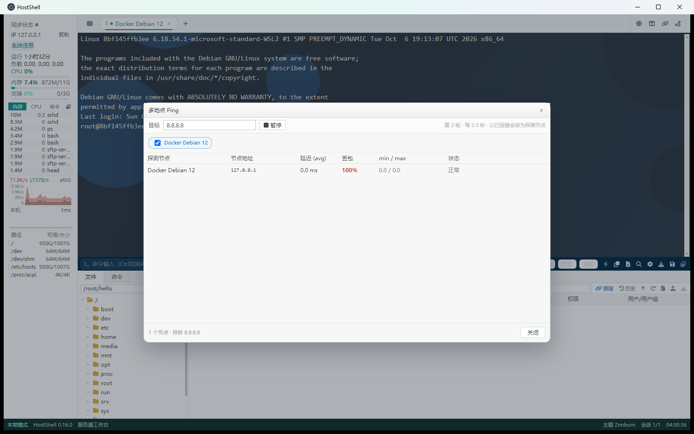
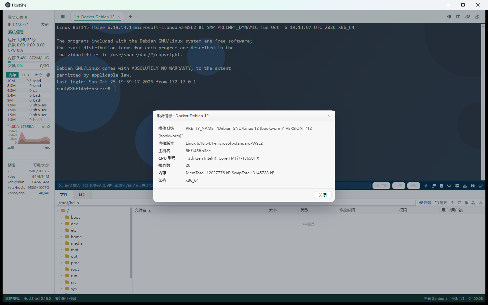
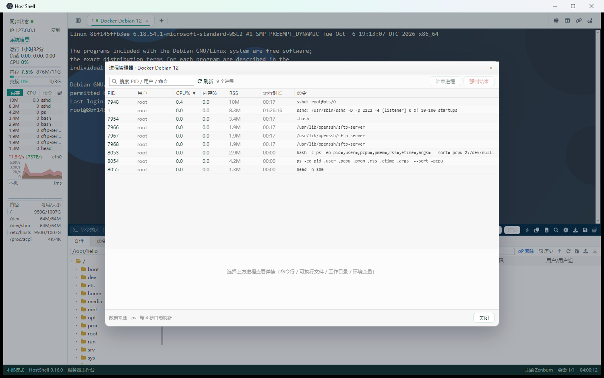
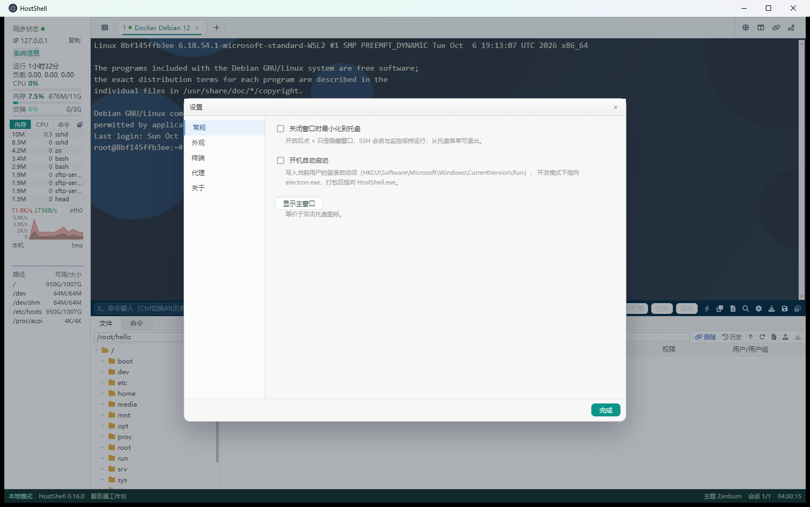
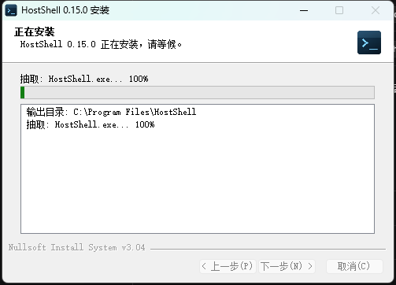
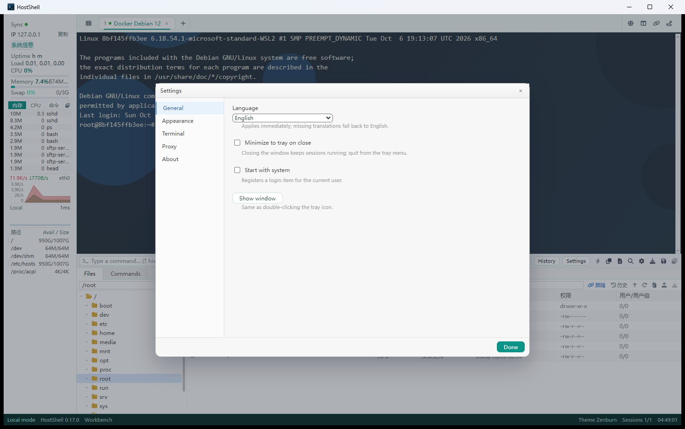

# HostShell

**中文** · [English](README.en.md) · [日本語](docs/i18n/README.ja.md) · [한국어](docs/i18n/README.ko.md) · [Deutsch](docs/i18n/README.de.md) · [Français](docs/i18n/README.fr.md) · [Español](docs/i18n/README.es.md) · [Русский](docs/i18n/README.ru.md) · [Português](docs/i18n/README.pt-BR.md)

一体化服务器管理工具：SSH 终端、SFTP 文件管理、实时监控、隧道、Zmodem，装进同一个窗口。

> 开源（MIT）、本地优先。界面采用左侧图标导航 + 卡片式终端的模块化布局，
> 后续会以同一套框架接入 Redis / SQL 管理与 AI 辅助能力。


| | |
|---|---|
|  |  |
|  |  |
|  |  |
|  |  |
|  |  |

## 功能

| 模块 | 能力 |
|---|---|
| 连接管理 | 树形分组、拖拽改归属、Ctrl/Shift 多选、批量打开/删除、从 JSON 文件导入、密码经系统安全存储加密 |
| 终端 | 多标签、拖拽排序、左右分屏、广播输入、搜索、124 套配色、背景图、字体与编码可调 |
| SFTP | 同屏文件面板、跟随终端目录、上传/下载、拖拽上传、多选批量操作、权限/重命名/新建、打包传输（tar.gz） |
| 监控 | CPU/内存/交换/负载、进程表（内存/CPU/命令排序）、网卡流量、磁盘容量、Ping 延迟丢包 |
| 工具 | 进程管理器、主机检测（tracert 逐跳）、系统信息、端口转发、多地点 Ping、Zmodem（rz/sz 双向） |
| 命令 | 命令输入框：历史、补全、远端路径候选；快捷命令分组与模板参数 |
| 连接方式 | SSH（密码/密钥）、Windows 远程桌面（生成 .rdp 调 mstsc）、HTTP CONNECT / SOCKS5 代理 |
| 桌面 | 托盘、关闭到托盘、开机启动、单实例、窗口位置记忆 |
| 国际化 | 简中 / English / 日本語 / 한국어 / Deutsch / Français / Español / Русский / Português (BR)，默认跟随系统 |
| 模块化界面 | 左侧图标导航（连接 / 监控 / 文件 / 命令 / 设置），终端卡片化，为数据库与 AI 模块预留入口 |

## 快速开始

```powershell
npm install
npm run dev        # 开发模式（HMR）
npm run build      # 构建到 out/
npm start          # 预览构建产物
```

要求：Node 18+，Windows / macOS / Linux。

### 打包与分发

```powershell
npm run dist:dir     # 免安装目录 → release/win-unpacked/HostShell.exe
npm run dist:setup   # 安装包 → release/HostShell-<version>-setup.exe（NSIS）
```

| 产物 | 说明 |
|---|---|
| `release/win-unpacked/` | 免安装目录版（232 MB），双击 `HostShell.exe` 直接运行 |
| `release/HostShell-0.17.1-win.zip` | 绿色版压缩包 **约 97 MB**，解压即用 |
| `release/HostShell-0.17.1-setup.exe` | 安装包 **约 72 MB**：Program Files 安装、快捷方式、控制面板卸载项 |
| `release/HostShell-0.17.1.AppImage` | Linux 免安装包 **约 74 MB**（CI 构建） |
| `release/hostshell_0.17.1_amd64.deb` | Debian/Ubuntu 安装包 **约 74 MB**（CI 构建） |

安装包由 `build/installer.nsi` 编译（NSIS 3.04），静默安装/卸载已实测：

```powershell
release\HostShell-0.17.1-setup.exe /S /D=C:\path\to\install
```

> 首次构建安装包需要 NSIS：下载 `nsis-3.0.4.1.7z`（electron-builder-binaries），
> 解压到 `%LOCALAPPDATA%\electron-builder\Cache\nsis\nsis-3.0.4.1`，然后 `makensis /INPUTCHARSET UTF8 build/installer.nsi`。

CI：推送到 `main` 自动跑类型检查与构建（`.github/workflows/ci.yml`）；
推送 `v*` tag 自动构建 ZIP + 安装包并上传到 GitHub Release（`.github/workflows/release.yml`）；
Linux 包（AppImage / deb）由 `.github/workflows/linux.yml` 在 ubuntu 上构建，可手动触发。

### Linux

```bash
npm ci
npx electron-vite build
npx electron-builder --linux AppImage deb --x64
# 产物：release/HostShell-<version>-x86_64.AppImage、release/hostshell_<version>_amd64.deb
```

- AppImage：`chmod +x HostShell-*.AppImage && ./HostShell-*.AppImage`
- deb：`sudo dpkg -i hostshell_*.deb`（依赖缺失时 `sudo apt -f install`）
- 仅 Windows 有的能力：RDP（`mstsc`）在 Linux 上会禁用；其余 SSH / SFTP / 监控 / Zmodem / 代理均可用
- 开机自启：Linux 下写入 `~/.config/autostart/hostshell.desktop`
- 密码加密依赖系统密钥环（GNOME Keyring / KWallet）；没有可用密钥环时回退为 `plain:` 本地编码，连接时仍可用但不具备系统级加密

### 真实服务器联调（Docker）

仓库自带一个最小 SSH 服务器镜像（Debian 12 + OpenSSH 9.2 + lrzsz）：

```powershell
docker build -t hostshell/sshd:latest tools/docker/sshd
docker run -d --name hostshell-sshd -p 127.0.0.1:2223:2222 hostshell/sshd:latest
# 连接：127.0.0.1:2223  root / hostshell
```

镜像里的 `sz`/`rz` 可直接用来验证 Zmodem 双向传输。

### 没有服务器？用内置 Mock

```powershell
node tools/mock-ssh-server.cjs 2222
```

在「连接管理器」里新建 `127.0.0.1:2222`，用户 `root`，密码任意。Mock 会返回真实的 Ubuntu 欢迎语、
`docker ps` 输出、`/proc` 指标和一棵虚拟目录树，用于端到端联调与截图。

## 数据与安全

- 配置目录：`%APPDATA%\HostShell\data`（macOS/Linux 为 Electron userData 对应路径）
- 连接：`conn/<id>_connect_config.json`，一条连接一个文件，便于备份与迁移
- 密码：优先经 Electron `safeStorage`（DPAPI/Keychain）加密，存为 `enc:`；无法解密的外部密文标记 `legacy:`，连接时提示重输
- 全部数据只在本机，不上传任何服务器

## 工程结构

```
src/
  main/        Electron 主进程：窗口/托盘/store/session/monitor/sftp/proxy/zmodem
  preload/     contextBridge API
  renderer/    React 界面：components / state / lib / styles.css
build/         图标与 NSIS 安装脚本
tools/         mock SSH 服务器、Docker 联调镜像、CDP 驱动
docs/          01 功能清单、02 架构设计、03 验收报告、shots/ 截图
```

## 技术栈

Electron 33 · React 18 · TypeScript · electron-vite · xterm.js 5 · ssh2 · CodeMirror 6 · zustand · FontAwesome

## 文档

- [02 架构设计](docs/02-架构设计.md)
- [03 验收报告](docs/03-验收报告.md)

## 赞助

HostShell 是 MIT 开源项目，不卖授权、没有"升级"版本。如果它帮到了你，可以自愿请作者喝杯咖啡：

| 支付宝 | 微信支付 |
|---|---|
|  |  |

赞助完全自愿，不影响任何功能；也欢迎用 Issue / PR 的方式参与。

## 声明

MIT License。图标、配色与文案均为本项目自有资源；配色数据来自社区 iTerm2 配色方案（MIT）。
