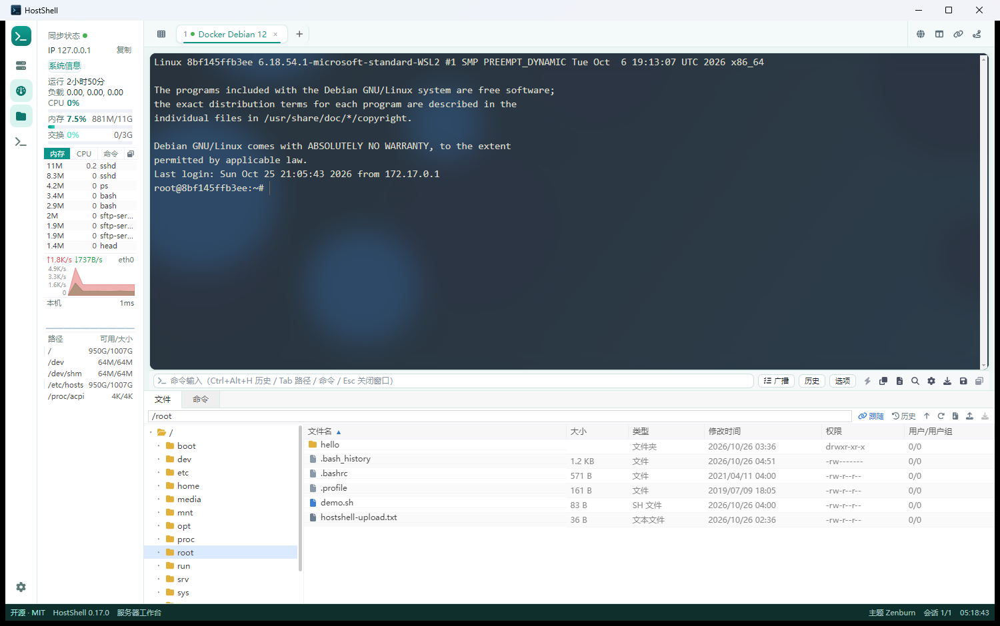

# HostShell

[中文](../README.md) · [English](../README.en.md) · [日本語](README.ja.md) · **한국어** · [Deutsch](README.de.md) · [Français](README.fr.md) · [Español](README.es.md) · [Русский](README.ru.md) · [Português](README.pt-BR.md)

SSH 터미널, SFTP, 실시간 모니터링, 터널, Zmodem을 하나의 창에 담은 서버 관리 도구입니다.

> MIT 오픈소스, 로컬 우선. 왼쪽 아이콘 레일과 카드형 터미널 구조라
> 향후 Redis / SQL 관리와 AI 기능도 같은 화면에 추가할 수 있습니다.



## 주요 기능

- **연결 관리**: 트리 그룹, 드래그로 이동, 다중 선택, 일괄 열기/삭제, JSON 가져오기
- **터미널**: 탭, 좌우 분할, 브로드캐스트 입력, 검색, 124가지 색상, 배경 이미지
- **SFTP**: 터미널 경로 따라가기, 업로드/다운로드, 드래그 앤 드롭, 일괄 작업, tar.gz 전송
- **모니터링**: CPU / 메모리 / 스왑 / 부하, 프로세스 목록, 네트워크, 디스크, Ping
- **도구**: 프로세스 관리자, 호스트 진단(traceroute), 시스템 정보, 포트 포워딩, 다중 지역 Ping, Zmodem(송수신)
- **명령**: 기록, 자동완성, 원격 경로 후보, 빠른 명령(템플릿 인자)
- **연결 방식**: SSH(비밀번호/키), Windows 원격 데스크톱, HTTP CONNECT / SOCKS5 프록시
- **데스크톱**: 트레이, 트레이로 최소화, 자동 시작, 단일 인스턴스
- **다국어**: 한국어 / English / 简体中文 / 日本語 / Deutsch / Français / Español / Русский / Português (BR)

## 빠른 시작

```powershell
npm install
npm run dev        # 개발 모드
npm run build      # out/ 로 빌드
npm start          # 빌드 결과 미리보기
```

Node 18 이상. Windows / macOS / Linux 지원.

### 패키징

```powershell
npm run dist:dir     # 포터블 폴더 → release/win-unpacked/HostShell.exe
npm run dist:setup   # 설치 프로그램 → release/HostShell-<version>-setup.exe
```

| 산출물 | 설명 |
|---|---|
| `release/win-unpacked/` | 포터블 폴더(232 MB) |
| `release/HostShell-0.17.0-win.zip` | 포터블 ZIP(97.3 MB) |
| `release/HostShell-0.17.0-setup.exe` | 설치 프로그램(71.7 MB) |

## 후원

HostShell은 MIT 오픈소스이며 라이선스 판매나 "업그레이드" 버전이 없습니다.
도움이 되었다면 자발적으로 커피 한 잔을 후원할 수 있습니다.

| Alipay | WeChat Pay |
|---|---|
|  |  |

후원은 전적으로 자발적이며 기능에 영향을 주지 않습니다. Issue / PR도 환영합니다.

## 문서

- 상세 문서(중국어): [아키텍처](../02-架构设计.md) · [검수 보고서](../03-验收报告.md)
- [English README](../README.en.md)
